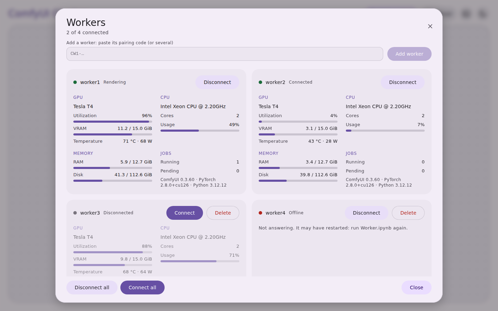

# ComfyCluster
For Controller Instances:
[](https://colab.research.google.com/github/AlamandaCathartica/ComfyCluster/blob/main/Controller.ipynb)
For Worker Instances:
[](https://colab.research.google.com/github/AlamandaCathartica/ComfyCluster/blob/main/Worker.ipynb)

Run **ComfyUI** on several Google Colab accounts at once. One **controller** gives you the full ComfyUI interface in a single clean page. Four **workers** only render. Together they make five GPUs that share your generations.



## What it does

- **One page.** The controller GUI shows a title and a large rounded frame with ComfyUI inside. Light and dark theme.
- **Worker monitor.** The **Workers** button next to the theme toggle opens a floating window. It shows each worker's status, GPU, VRAM, and running and pending jobs, and lets you **Connect** or **Disconnect** any worker (or all at once).
- **Worker details.** The Workers window is a large dialog with one card per worker: GPU (model, utilization, VRAM, temperature, power), CPU (model, cores, usage), RAM, disk, running and pending jobs, and the ComfyUI, PyTorch and Python versions. CPU and GPU load come from a small add-on (`engine/comfycluster_stats.py`) that each machine installs when its notebook runs; a worker started before this update still shows GPU memory, RAM and jobs, but not CPU or GPU load until you run its notebook again.
- **Server log.** The icon-only button left of the theme toggle opens the log window. Pick the machine (Controller or any worker) and the log (Engine = what the notebook does, ComfyUI = what ComfyUI prints). Worker logs are read from the worker over its tunnel through the same add-on, so a worker started before this update needs its notebook run again. **Clear** hides what is shown now and keeps only new lines.
- **Upload.** The **Upload** button next to Workers sends models (into the chosen `models/` folder) or custom nodes (`.zip` or `.py`) to the controller. Large files go up in 32 MB slices, so they pass through the tunnel and a dropped connection resumes. Press **R** in ComfyUI to see a new model; restart ComfyUI to load a new custom node.
- **Delete a worker.** A worker that is disconnected or offline gets a **Delete** button next to Connect. It asks for a second click, then removes the worker from the monitor, from ComfyUI-Distributed's config and from the saved list. A connected, online worker cannot be deleted: disconnect it first. To bring it back later, paste its pairing code again.
- **Add workers in the page.** Each worker prints a short pairing code. Open the **Workers** window, paste the code (or several, one per line or separated by spaces) into **Add a worker** and press **Add worker**. The controller checks that the worker answers, registers it with [ComfyUI-Distributed](https://github.com/robertvoy/ComfyUI-Distributed) and remembers it if the controller restarts. Pasting the new code of a restarted worker replaces its old address.
- **Different accounts are fine.** Nothing is shared through Google Drive, so every tab can use its own account.
- **No uploads.** The notebooks download the code from this repository each time they run, and the GUI link is protected by a private key.

## How it works

Distributed generation runs whole images in parallel: the same workflow goes to every machine with a different seed, and the collector node brings the results back to the controller. A single image is never split across GPUs, except in tiled upscaling.

## How to use it

1. Open `Worker.ipynb` in Colab on each worker account (choose a **GPU runtime**). Give each a different `WORKER_NAME`, run the cell and copy the pairing code it prints (starts with `CW1-`).
2. Open `Controller.ipynb` on the controller account and run the cell.
3. Open the private link it prints. Click **Workers**, paste each pairing code into **Add a worker** and press **Add worker**.
4. Build your workflow, add the Distributed nodes (for example Distributed Seed and Distributed Collector) and queue.

Keep every notebook cell running. If a worker restarts it gets a new address: paste its new code in the Workers window. If you run the controller cell again, workers that still answer are kept.

## Models

`models.json` lists what every machine downloads. Edit it in your fork so the controller and workers always match. Gated models need a Colab secret named `HF_TOKEN`.

## Notes

- **Pairing codes are checked when you add them.** A code is refused if it is damaged, if the worker does not answer (start or restart its notebook and copy a fresh code), or if its address is already paired under another name. The names `all` and `controller` are reserved, so do not use them as `WORKER_NAME`. A worker that goes away stays in the list as Offline until you delete it.
- If a worker you added does not appear in ComfyUI-Distributed's own panel, reload the ComfyUI page. The extension reads the worker list from its config file, and may only do so when it loads.
- Anyone who has a worker's address can read its logs and load figures through the add-on, like they can use its ComfyUI. Keep the pairing codes private.
- **Uploads reach the controller only.** Workers keep their own files. For models every machine needs, add them to `models.json`. Custom nodes uploaded here are not installed on workers, and their `requirements.txt` is not installed automatically.
- **Connect / Disconnect** switches a worker on or off in ComfyUI-Distributed's config (the `enabled` flag) and in the monitor. A disconnected worker keeps running but is not meant to receive new jobs. Whether the extension re-reads the file immediately or only on its next reload depends on its version.
- ComfyUI generally needs a paid Colab plan. Use each account within its own plan limits.
- The controller's ComfyUI address and each worker's address are public Cloudflare quick-tunnel URLs. Only the GUI link is protected by a key, so keep the codes and links private.
- The worker entries written for ComfyUI-Distributed follow its config format as understood at the time of writing. If workers do not appear in its panel, add them there (Add Worker > Remote); the addresses are in the worker logs.

## Run the GUI locally

```
pip install -r requirements.txt
python gui/comfycluster_gui.py --demo
```

Then open `http://127.0.0.1:7860`. With a ComfyUI already running on this machine, add `--comfy-url http://127.0.0.1:8188 --comfy-local http://127.0.0.1:8188`.

## Repository layout

| Path | What it is |
|---|---|
| `Controller.ipynb` | Notebook for the controller account: clones this repo, starts ComfyUI and opens the GUI (workers are added in the page) |
| `Worker.ipynb` | Notebook for each worker account: starts a headless ComfyUI and prints the pairing code |
| `models.json` | Models downloaded by every machine |
| `engine/controller.py` | Starts ComfyUI, registers workers, starts the GUI and its tunnel |
| `engine/worker.py` | Starts ComfyUI and its tunnel, writes the pairing code |
| `engine/comfy.py` | Installs and launches ComfyUI and ComfyUI-Distributed, downloads models |
| `engine/comfycluster_stats.py` | ComfyUI add-on that serves CPU, RAM, disk and GPU load to the monitor |
| `engine/logtail.py` | Reads the end of a log file (used by the GUI and the worker add-on) |
| `engine/pairing.py` | Makes and reads pairing codes |
| `gui/comfycluster_gui.py` | The GUI server (worker monitor, adding workers by code, logs, uploads) |
| `gui/web/index.html` | The web page |
| `gui/tunnel.py` | Cloudflare quick tunnel helper |
| `VERSION` | Shown in the notebook output and the server log |
